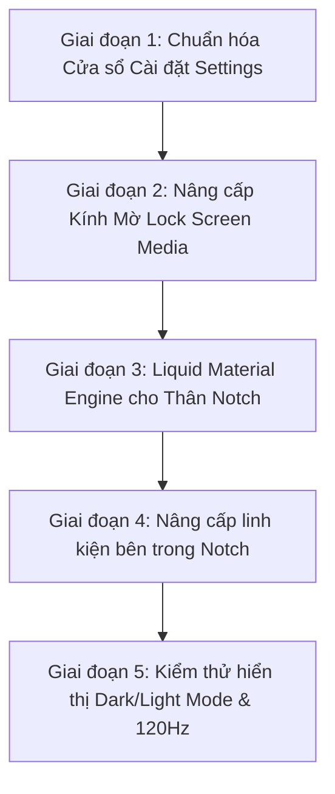

# 💎 NotchPulse Pure Apple Native Transformation Blueprint
> **Tài liệu Kế hoạch Chuyển đổi Toàn diện Kiến trúc & Giao diện NotchPulse đạt chuẩn Apple Native 100% (macOS Sequoia & Sonoma Pure HIG)**

---

## 🧭 1. TÔN CHỈ BẤT KHẢ XÂM PHẠM (CORE MANIFESTO)

> ⭐️ **"Tối đa Native – Không chế cháo – Tự động hòa nhập 100% với macOS"**

1. **Tuyệt đối KHÔNG chế tạo thêm tùy chọn giao diện nhân tạo (Zero Custom Toggles):**
   - Xoá bỏ hoàn toàn các nút chọn "Kính A, Kính B, hay Nền đen lì" trong Settings.
   - Ứng dụng **tự động đồng bộ 100% với hệ thống macOS**:
     - **Dark Mode**: Thân notch/card khi mở tự hoá thành kính mờ hun khói sang trọng (`.regularMaterial` / `.ultraThinMaterial` dark vibrancy), chữ và icon tự chuyển sang màu trắng tương phản chuẩn HIG (`.primary`, `.secondary`).
     - **Light Mode**: Thân notch/card khi mở tự hoá thành kính mờ băng tuyết trắng sữa trong veo, chữ và icon tự chuyển sang màu đen/xám than tương phản cao.
     - Tự động thay đổi màu nhấn theo **Accent Color** mà người dùng cài trong *System Settings > Appearance* của macOS.

2. **Quy tắc "Mỏ Neo Đen Tuyệt Đối" khi Đóng & Inline (The Black Anchor Rule):**
   - **Áp dụng cho cả Màn hình MacBook có Notch lẫn Màn hình Ngoại vi hiển thị dạng Notch**:
     - **Khi ĐÓNG (Closed):** Thân notch luôn là **Đen Tuyền Tuyệt Đối (`#000000`)** đính sát mép trên cùng màn hình (có 2 tai thỏ bo cong mềm mại ra hai bên).
     - **Khi INLINE (Mini HUD thu gọn):** Các trạng thái mini (sóng nhạc, icon pin sạc, âm lượng mini) nằm trọn trên nền đen nguyên bản để không bao giờ lộ camera hoặc viền nhựa bezel.
     - **Với Màn hình chọn kiểu Dynamic Island (Viên thuốc lơ lửng):** Lúc đóng/inline là một viên thuốc đen tuyền nhỏ gọn trôi nổi ở đỉnh.

3. **Quy tắc "Phiến Kính Native Siêu Nét" khi MỞ RỘNG (The Liquid Expanded Drawer):**
   - Khi hover hoặc click để mở bung Notch:
     - **Màn hình hiển thị dạng NOTCH (MacBook hoặc Màn ngoài):** Cục tai thỏ ở đỉnh mép trên **VẪN GIỮ NGUYÊN CỤC ĐEN** làm điểm neo (Camera Anchor) che mắt camera vật lý/mép viền. Chỉ có **toàn bộ phần thân mở rộng trượt xuống bên dưới** mới biến đổi thành **Phiến kính Native (`NSVisualEffectView` / SwiftUI Material)**.
     - **Màn hình hiển thị dạng DYNAMIC ISLAND (Viên thuốc nổi):** Toàn bộ viên thuốc nở to ra thành một tấm thẻ kính mờ trôi nổi đối xứng bốn góc.
   - Bao quanh phiến kính là đường viền tóc chuẩn Apple (`strokeBorder(Color.white.opacity(0.12))` ở Dark Mode và `Color.black.opacity(0.08)` ở Light Mode), tạo chiều sâu lơ lửng đẳng cấp.

4. **Bí thuật Vibrancy & Hiển thị Sắc nét Tuyệt đối (Apple Optical Vibrancy):**
   - Không dùng màu bệt phẳng (`Color.white` hay `Color(white: 0.10)`).
   - Dùng 100% cơ chế **Vibrancy Native của Apple** để trích xuất ánh sáng từ hình nền phía sau, tự động khử răng cưa Sub-pixel cho màn hình Retina, đảm bảo mọi dòng chữ, icon, thanh trượt luôn **sắc sảo, sáng rõ, không bao giờ bị nhoè, đục hay chìm màu**.

---

## 🏗️ 2. KIẾN TRÚC THỊ GIÁC: NOTCH vs DYNAMIC ISLAND

### A. MÀN HÌNH HIỂN THỊ DẠNG NOTCH (MacBook & Màn hình ngoài chọn Notch)
```
1. TRẠNG THÁI ĐÓNG (CLOSED):
   ┌────────────────────────────────┐
   │     █ █ █ █ █ █ █ █ █ █ █      │  <- ĐEN TUYỀN 100% (#000000)
   └────────────────────────────────┘     Gắn sát mép trên, hòa vào viền máy.

2. TRẠNG THÁI INLINE MINI (INLINE HUD):
   ┌────────────────────────────────┐
   │ 🔊 50%  █ █ Camera █ █  🔋 98% │  <- VẪN GIỮ NỀN ĐEN 100%
   └────────────────────────────────┘     Chữ và icon trắng nhỏ gọn gắn 2 bên tai.

3. TRẠNG THÁI MỞ RỘNG (EXPANDED):
   ┌────────────────────────────────┐
   │ █ █ █ █ Camera Anchor █ █ █ █  │  <- VẪN GIỮ NGUYÊN CỤC ĐEN Ở ĐỈNH
   │────────────────────────────────│
   │                                │  <- THÂN NỞ RỘNG: KÍNH MỜ NATIVE
   │     TỰ ĐỘNG THEO HỆ THỐNG:     │     - Tự động mờ sương theo Dark/Light
   │   - Khúc xạ hình nền Desktop   │     - Chữ & Icon tự nổi sắc nét (Vibrancy)
   │   - Viền phản xạ ánh sáng mảnh │     - 100% Metal GPU tăng tốc, 120Hz
   │                                │
   └────────────────────────────────┘
```

### B. MÀN HÌNH HIỂN THỊ DẠNG DYNAMIC ISLAND (Viên thuốc nổi)
```
1. TRẠNG THÁI ĐÓNG / INLINE:
   ╭────────────────────────────╮
   │ 🔊 50%  NotchPulse   🔋 98% │  <- VIÊN THUỐC ĐEN NỔI LƠ LỬNG
   ╰────────────────────────────╯     Đổ bóng nhẹ, cách mép trên một khoảng.

2. TRẠNG THÁI MỞ RỘNG (EXPANDED):
   ╭────────────────────────────────╮
   │                                │  <- TOÀN BỘ NỞ THÀNH THẺ KÍNH TRÔI NỔI
   │   PHIẾN KÍNH LIQUID NATIVE     │     - Bo cong 4 góc đối xứng hoàn hảo
   │   - Tự động theo Dark/Light    │     - Không cần cục đen che đỉnh
   │   - Hiển thị siêu sắc nét      │     - Viền bắt sáng siêu mỏng
   │                                │
   ╰────────────────────────────────╯
```

---

## 🎵 3. CHUẨN HOÁ TRÌNH PHÁT NHẠC LOCK SCREEN (LOCK SCREEN MEDIA)

Xoá bỏ hoàn toàn nền bệt màu trắng/xám hiện tại (`Color.white` / `Color(white: 0.10)`), chuyển sang chuẩn Apple Native:
1. **Compact Player Card (Thẻ Mini ở Màn hình Khoá):**
   - Sử dụng `.ultraThinMaterial` / `NSVisualEffectView` làm mờ trực tiếp hình nền Lock Screen (hoặc video nền Dynamic Wallpaper của macOS).
   - Tự động theo hệ thống: Kính hun khói khi Dark Mode, kính sữa tuyết khi Light Mode.
   - Viền bo góc `RoundedRectangle(cornerRadius: 26, style: .continuous)` với viền tóc gradient phản quang mảnh `0.8pt`.
   - Vẫn neo cố định trên màn hình được chỉ định, không nhảy lung tung theo chuột khi cắm nhiều màn hình.
2. **Full-Screen Immersive Player (Chế độ Phóng to Toàn màn hình):**
   - Giữ nền Ambient Blur phóng to từ ảnh bìa album art.
   - Cột lời bài hát hiển thị font SF Pro Rounded cỡ lớn, dòng đang hát sáng rực rỡ, dòng chưa hát mờ dần và làm mờ nhẹ chuẩn Apple Music Sing.

---

## ⚙️ 4. CHUẨN HÓA CỬA SỔ CÀI ĐẶT (SETTINGS - 100% APPLE HIG)

Xóa bỏ thanh header tự chế (`SettingsDetailHeaderBar`), đưa về chuẩn mực Sequoia / Sonoma:

```
┌──────────────────────────────────────────────────────────────┐
│ [● ● ●]  General Settings                       (Search Bar) │ <- macOS Native Unified Window Toolbar
├───────────────┬──────────────────────────────────────────────┤
│ ⚙️ General     │  ┌────────────────────────────────────────┐  │
│ 🎨 Appearance  │  │ [✨ Tính năng & Giới thiệu]          > │  │ <- macOS Inset Grouped Card
│ 🎵 Media       │  └────────────────────────────────────────┘  │    (Bo góc viền kính mờ tự nhiên)
│ 📅 Calendar    │  ┌────────────────────────────────────────┐  │
│ 🔒 Face ID     │  │ Khởi động cùng Mac           [ Bật ]  │  │
│ 📊 Stats       │  │ Tự động kiểm tra bản mới     [ Bật ]  │  │
│ 💨 Fan & SMC   │  └────────────────────────────────────────┘  │
│ (Sidebar Kính)│  (Nền toàn bộ tự động theo Dark/Light macOS) │
└───────────────┴──────────────────────────────────────────────┘
```

1. **Loại bỏ tùy chọn giao diện thủ công:** Tự động bắt theo `@Environment(\.colorScheme)`.
2. **Áp dụng `.formStyle(.grouped)`:** Thẻ cài đặt bo cong, viền mờ tinh tế, đổ bóng chuẩn hệ thống.
3. **Thanh Toolbar Hệ thống:** Dùng `.toolbar` chuẩn SwiftUI macOS với nút đóng/thu nhỏ tích hợp tự nhiên.
4. **Sidebar Kính Mờ:** Dùng `SidebarListStyle()` với hiệu ứng nền kính `sidebar` native của AppKit.

---

## 🧩 5. NÂNG CẤP CÁC LINH KIỆN NỘI BỘ NOTCH (COMPONENTS)

Loại bỏ toàn bộ các khối màu đen thô cứng bên trong thân notch khi mở rộng, chuyển sang linh kiện native:

| Thành phần | Hiện tại (Custom cũ) | Thiết kế Pure Native Mới |
| :--- | :--- | :--- |
| **Thanh chuyển Tab** | Các viên thuốc `Capsule().fill(.black)` tự vẽ, viền sắc cạnh. | Thanh phân đoạn (Segmented Control) kính mờ, icon tự động bắt sáng khi active. |
| **Thanh trượt (Slider)** | Tự vẽ hình chữ nhật màu xanh/cam cố định bằng DragGesture. | Thanh trượt Capsule kính mờ viền sáng chuẩn Apple, có độ nảy lò xo tự nhiên khi kéo chạm biên. |
| **Trình phát Nhạc (Media)** | Khung nền đen đè lên. | Bề mặt kính mờ khúc xạ nhẹ màu sắc của bìa album (Dynamic Ambient Tinting) mà không dùng hộp đen. |
| **Lịch Âm & Dương** | Bảng vuông nền đen lì. | Lịch kính mờ, ngày hiện tại tự động dùng màu nhấn hệ thống (`Color.accentColor`). |
| **Kệ File & Clipboard** | Các ô xám đặc. | Ô kính mờ nhận diện dạng tệp, hover có hiệu ứng sáng viền mềm mại. |
| **Văn bản & Biểu tượng** | Ép chết màu trắng hoặc màu xám hex. | Dùng màu ngữ nghĩa hệ thống: `.primary`, `.secondary`, `.tertiary` để luôn hiển thị sắc sảo ở cả Light Mode lẫn Dark Mode. |

---

## 🛡️ 6. QUY TẮC AN TOÀN BẤT KHẢ XÂM PHẠM (GOLDEN RULES)

Khi thực thi mã nguồn, **bắt buộc tuân thủ 100%** các quy tắc sau:

1. **Bảo toàn Hoạt ảnh Đóng/Mở (Animation Continuity):**
   - **TUYỆT ĐỐI CẤM** dùng cấu trúc `if vm.notchState == .open { ... } else { ... }` ở lớp vỏ ngoài của Notch. Việc tráo đổi danh tính View (View Identity Swap) sẽ gây hiện tượng vỡ khung hình hoặc mở giật bụp.
   - Phải sử dụng phép biến đổi liên tục (Continuous Interpolation) cho lớp nền:
     ```swift
     // Khi đóng: đen 100%. Khi mở: hòa vào vật liệu kính mờ tự nhiên
     .background(
         ZStack {
             if vm.notchState == .closed {
                 Color.black
             } else {
                 Rectangle().fill(.ultraThinMaterial)
             }
         }
     )
     ```
2. **Quy tắc đối xứng hình học 14px:**
   - Luôn duy trì padding ngang đối xứng tuyệt đối giữa trạng thái đóng và mở để khi co giãn notch không bị giật sang hai bên.
3. **Face ID Top-Most Layer (`.zIndex(999)`):**
   - Hệ thống camera Face ID và hoạt ảnh nhận diện luôn nằm ở lớp cao nhất, không bị bất kỳ lớp kính hay hiệu ứng nào che khuất.
4. **Không làm tăng tải hệ thống (Performance First):**
   - Tận dụng tối đa bộ kết xuất phần cứng Metal của Apple có sẵn trong `NSVisualEffectView` / `Material`.
   - Mức tiêu thụ RAM duy trì ở mức siêu nhẹ (~35–50MB), đảm bảo tần số quét 120Hz mượt mà trên màn hình ProMotion.

---

## 🚀 7. LỘ TRÌNH THỰC THI (IMPLEMENTATION PHASES)



### 📍 Giai đoạn 1: Chuẩn hóa Cửa sổ Settings (Pure HIG)
- [ ] Xóa bỏ `SettingsDetailHeaderBar` tự chế.
- [ ] Chuyển các tab cài đặt sang cấu trúc thẻ Inset Grouped (`.formStyle(.grouped)`).
- [ ] Đồng bộ hóa màu chữ, thanh trượt và toggle theo bảng màu hệ thống macOS.
- [ ] Đảm bảo Settings hiển thị hoàn hảo trên cả Dark Mode và Light Mode.

### 📍 Giai đoạn 2: Nâng cấp Kính Mờ Native cho Lock Screen Media
- [ ] Thay nền bệt trắng/xám hiện tại trong `LockScreenMediaView.swift` bằng `.ultraThinMaterial` / `NSVisualEffectView`.
- [ ] Bổ sung viền tóc phản quang mỏng bo cong góc 26px.
- [ ] Tự động thích ứng màu sắc và chữ theo hình nền khoá và chế độ Dark/Light.

### 📍 Giai đoạn 3: Xây dựng Liquid Material Engine cho Notch
- [ ] Cập nhật [ContentView.swift](file:///Users/hieukunn/Learning%20ITM/My%20project/NotchPulse/NotchPulse/ContentView.swift): Tích hợp lớp nền chuyển đổi Đóng (Black Anchor) -> Mở (Native Material).
- [ ] Duy trì cụm đen che đỉnh camera vật lý khi ở kiểu Notch (cả màn MacBook và màn ngoài).
- [ ] Thêm đường viền tóc phản quang mảnh chuẩn Apple bao quanh thân mở rộng.

### 📍 Giai đoạn 4: Nâng cấp Linh kiện bên trong Notch
- [ ] Chuyển đổi Card nhạc, Bảng lịch, Ngăn quạt tản nhiệt, Kệ file sang vật liệu kính mờ.
- [ ] Thay thế các nút Tab bọc đen lì sang thanh phân đoạn kính mờ tinh tế.
- [ ] Thay thế thanh trượt Volume / Brightness / Fan sang Capsule chuẩn hệ thống.

### 📍 Giai đoạn 5: Kiểm thử và Hoàn thiện
- [ ] Test thực tế khi đổi hình nền Desktop (sáng, tối, rực rỡ, ảnh phong cảnh).
- [ ] Test chuyển đổi qua lại giữa Light Mode và Dark Mode trong System Settings.
- [ ] Kiểm tra độ mượt 120Hz ProMotion và theo dõi RAM/CPU không bị rò rỉ.

---

*Bản kế hoạch này là kim chỉ nam tối thượng cho quá trình đưa NotchPulse trở thành ứng dụng Native đỉnh cao nhất trên macOS.*
