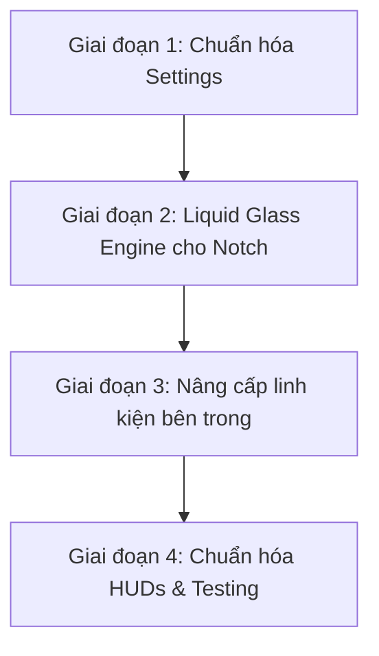

# 💎 NotchPulse Native Transformation Blueprint
> **Kế hoạch chuyển đổi toàn diện kiến trúc & giao diện NotchPulse đạt chuẩn Apple Native 100% (macOS Sequoia / Sonoma HIG & Liquid Glass Experience)**

---

## 🎯 1. Tầm nhìn & Mục tiêu (Vision & Objectives)

### Thực trạng hiện tại
- NotchPulse sở hữu nền tảng công nghệ rất mạnh (Face ID Neural Engine, điều khiển quạt phần cứng SMC, Audio Engine độc lập từng app, hỗ trợ đa màn hình).
- **Hạn chế:** Giao diện đang bị **"hardcode"** (ép chết màu nền đen `#000000`, thanh trượt tự chế, các nút bấm bọc viên thuốc đen lì, cửa sổ Cài đặt dùng thanh header tự chế). Do đó, app chưa toát lên vẻ đẹp chuẩn mực của macOS và chưa tự động thích ứng với ngôn ngữ thiết kế của các bản macOS mới (như Sequoia hay Sonoma).

### Mục tiêu chuyển đổi
1. **Sánh ngang và vượt trội các app notch hàng đầu thế giới (NotchNook, MediaMate, Sleeve):**
   - Tai thỏ khi đóng hòa làm một với viền máy.
   - Khi mở ra: Biến hóa thành một **phiến kính mờ lơ lửng (Liquid Frosted Glass)** khúc xạ ánh sáng theo hình nền desktop, phản chiếu viền sáng tinh tế, tự động chuyển đổi Light/Dark mode mượt mà.
2. **Chuẩn hóa Cửa sổ Cài đặt (Settings) theo 100% Apple HIG:**
   - Sử dụng thanh công cụ hệ thống (macOS Native Window Toolbar).
   - Nội dung dạng các thẻ bo góc viền kính (`.formStyle(.grouped)`) giống hệt ứng dụng System Settings của macOS Sequoia.
3. **Giữ nguyên 100% hiệu năng và các tính năng cốt lõi:**
   - RAM duy trì ở mức siêu nhẹ (~35–50MB).
   - Đảm bảo 120Hz ProMotion mượt mà, không giật lag.
   - Không phá vỡ kiến trúc Face ID (`.zIndex(999)`) và cử chỉ vuốt kéo.

---

## 🏗️ 2. Kiến trúc diện mạo mới (The Liquid Glass Engine)

### 2.1. Đánh tráo thị giác giữa Đóng (Closed) và Mở (Open)

```
        ┌─────────────────────────┐
        │   Camera Notch (ĐEN)    │  <- [Trạng thái ĐÓNG]: 100% Black hòa vào bezel
        └─────────────────────────┘
                     │
                     ▼ (Hover / Click mở rộng)
   ┌───────────────────────────────────┐
   │ █ █ █ Camera Mask (ĐEN NEO) █ █ █ │  <- Giữ 1 dải đen nhỏ che camera vật lý
   │───────────────────────────────────│
   │                                   │
   │      LIQUID FROSTED GLASS         │  <- [Trạng thái MỞ]: Kính mờ xuyên thấu,
   │   (Vibrancy & Desktop Tinting)    │     khúc xạ màu hình nền, viền hairline sáng
   │                                   │
   └───────────────────────────────────┘
```

1. **Khi Đóng (Closed State):**
   - Vỏ ngoài giữ màu đen tuyền tuyệt đối (`.black`), gắn liền với viền trên màn hình để giấu camera vật lý.
2. **Khi Mở ra (Opened / Expanded State):**
   - **Đỉnh neo (Camera Anchor):** Duy trì một dải mặt nạ đen nhỏ đúng vị trí camera để không làm lộ cụm cảm biến.
   - **Thân mở rộng (Expanded Drawer):** Chuyển từ màu đen lì sang **Vật liệu kính mờ cao cấp (`.ultraThinMaterial` / `NSVisualEffectView`)**.
   - **Tự động bắt màu hình nền (Wallpaper Tinting):** Tự khúc xạ ánh màu theo ảnh nền người dùng đang đặt.
   - **Thích ứng giao diện:**
     - *Light Mode:* Kính mờ băng tuyết (Frosted Ice Glass), chữ đen tương phản cao.
     - *Dark Mode:* Kính hun khói sâu thẳm (Smoked Glass), chữ trắng nổi khối.
   - **Viền phản quang (Specular Glass Border):** Viền bo cong mảnh `Color.white.opacity(0.12)` bao quanh, tạo cảm giác một phiến kính lơ lửng có chiều sâu 3D.

---

## 🎨 3. Ba chế độ phong cách cho người dùng (Settings Appearance)

Cung cấp trong cài đặt 3 tùy chọn để người dùng tự do lựa chọn:

| Chế độ | Mô tả trải nghiệm | Đối tượng phù hợp |
| :--- | :--- | :--- |
| **1. Liquid Frosted Glass (Mặc định mới)** | Kính mờ xuyên thấu cao cấp chuẩn Sequoia, tự đổi theo hình nền, viền ánh sáng phản xạ. | Người dùng thích phong cách hiện đại, giống Control Center và NotchNook. |
| **2. Smoked Glass (Kính hun khói)** | Kính mờ tối màu trầm ấm, có chiều sâu viền nổi nhưng ít trong suốt hơn. | Người dùng thích sự kín đáo, tinh tế trên hình nền sáng. |
| **3. Classic Solid Black (Truyền thống)** | Giữ nguyên màu đen tuyền 100% kiểu Dynamic Island của iPhone như hiện tại. | Người dùng thích sự tối giản, quen thuộc từ các bản trước. |

---

## ⚙️ 4. Chuẩn hóa Cửa sổ Cài đặt (Settings Window - Pure HIG)

Hiện tại, `SettingsView.swift` bị cảm giác "tự chế" do có thanh header riêng và màu sắc gán cứng. Kế hoạch chuẩn hóa:

```
┌──────────────────────────────────────────────────────────────┐
│ [● ● ●]  General Settings                       (Search Bar) │ <- macOS Native Unified Toolbar
├───────────────┬──────────────────────────────────────────────┤
│ ⚙️ General     │  ┌────────────────────────────────────────┐  │
│ 🎨 Appearance  │  │ [✨ Feature Tour]                    > │  │ <- Grouped Card Style
│ 🎵 Media       │  └────────────────────────────────────────┘  │    (Bo góc viền kính)
│ 📅 Calendar    │  ┌────────────────────────────────────────┐  │
│ 🔒 Face ID     │  │ Notch Style      [ Dynamic Island v ] │  │
│ 📊 Stats       │  │ Material Mode    [ Liquid Glass   v ] │  │
│ ...           │  └────────────────────────────────────────┘  │
│ (Sidebar Kính)│  (Nền màu kính mờ tự co giãn theo macOS)     │
└───────────────┴──────────────────────────────────────────────┘
```

1. **Loại bỏ `SettingsDetailHeaderBar`:** Thay bằng `.toolbar { ToolbarItem(placement: .principal) { ... } }` chuẩn của macOS.
2. **Loại bỏ nút Quit tự chế ở góc trang:** Dùng menu Quit chuẩn hoặc đưa vào mục About/General đúng chuẩn Apple.
3. **Sidebar Kính mờ:** Dùng `SidebarListStyle()` kết hợp hiệu ứng rung động (`.material(.sidebar)`).
4. **Form Grouped:** Sử dụng `.formStyle(.grouped)` để toàn bộ cài đặt chia thành các thẻ bo góc viền sáng, đổ bóng nhẹ y hệt **System Settings trên macOS Sequoia**.

---

## 🧩 5. Nâng cấp các thành phần bên trong Notch

| Thành phần | Thiết kế hiện tại (Custom Cũ) | Thiết kế Native Mới (Liquid Native) |
| :--- | :--- | :--- |
| **Thanh Tab (Home, Shelf, Stats, Audio...)** | Các viên thuốc `Capsule().fill(.black)` tự vẽ, viền thô. | Thanh chuyển tab kính mờ phân đoạn mượt mà, icon bắt sáng khi active. |
| **Thanh trượt (Volume, Brightness, Fan Speed)** | DragGesture tự vẽ thanh màu xanh cố định. | Thanh trượt dạng Capsule kính mờ viền sáng, có phản hồi độ nảy lò xo khi kéo chạm biên. |
| **Card nhạc & Visualizer** | Hộp màu đen vuông vức đè lên. | Bề mặt kính mờ phản chiếu màu sắc của bìa album (Dynamic Ambient Album Tinting). |
| **Lịch Âm / Dương** | Bảng lịch nền đen lì. | Lịch hiển thị trên bề mặt kính mờ, ngày hiện tại nổi bật bằng màu nhấn hệ thống (`.controlAccentColor`). |
| **Ngăn nhiệt độ & Quạt (Thermal Drawer)** | Ngăn kéo màu xám xịt. | Khung kính hun khói với đồng hồ nhiệt độ vòng tròn phát sáng tinh xảo. |
| **Kệ file Shelf & Clipboard** | Ô màu xám thô. | Các ô kính mờ nhận diện tệp với hiệu ứng phát sáng nhẹ khi hover kéo thả file. |

---

## 🛡️ 6. Các quy tắc an toàn bất khả xâm phạm (Golden Rules)

Trong quá trình chuyển đổi, **TUYỆT ĐỐI TUÂN THỦ** các nguyên tắc cốt lõi đã đặt ra trong dự án:

1. **Bảo toàn chuyển động mượt mà (Không làm vỡ Animation):**
   - **CẤM** dùng `if/else` để đổi cấu trúc View khi đóng/mở vì sẽ gây ra lỗi "mở bùm / đóng bụp" (View Identity swap).
   - Biến đổi màu nền và độ mờ kính bằng cách nội suy liên tục (Interpolation):
     ```swift
     .background(
         MaterialBackgroundView(isOpen: vm.notchState == .open)
     )
     ```
2. **Quy tắc đối xứng Padding 14px:**
   - Khi đóng: Padding ngang là 14px (`cornerRadiusInsets.closed.bottom`).
   - Khi mở: Padding ngang là `10 + 4 = 14px`. Phải duy trì đối xứng tuyệt đối để không giật hình.
3. **Face ID Top-Most Layer (`.zIndex(999)`):**
   - Toàn bộ lớp phủ Face ID và hoạt ảnh quét camera luôn nằm ở tầng cao nhất, không bị lớp kính hay HUD che khuất.
4. **Hỗ trợ Đa Màn Hình & Dynamic Island:**
   - Màn hình có tai thỏ: Khớp chính xác với tai thỏ vật lý.
   - Màn hình phụ / Màn hình không tai thỏ: Nở thành viên thuốc kính mờ lơ lửng (Floating Island Glass) đẹp mắt.

---

## 🚀 7. Lộ trình triển khai (Phased Implementation Roadmap)



### 📍 Giai đoạn 1: Chuẩn hóa Cửa sổ Cài đặt (Settings HIG)
- [ ] Xóa bỏ `SettingsDetailHeaderBar` tự chế, chuyển sang thanh macOS Toolbar chuẩn.
- [ ] Áp dụng `.formStyle(.grouped)` cho toàn bộ các tab cài đặt (General, Appearance, Media, Fan...).
- [ ] Bổ sung cài đặt lựa chọn phong cách: `Liquid Frosted Glass` / `Smoked Glass` / `Classic Black`.

### 📍 Giai đoạn 2: Xây dựng Liquid Glass Engine cho Notch
- [ ] Cập nhật [ContentView.swift](file:///Users/hieukunn/Learning%20ITM/My%20project/NotchPulse/NotchPulse/ContentView.swift): Thay thế `.background(.black)` cố định bằng lớp vật liệu thông minh (Đóng = Black, Mở = Material).
- [ ] Xây dựng lớp mặt nạ neo giữ camera vật lý (Camera Anchor Mask) ở mép trên cùng.
- [ ] Thêm viền phản quang kính `strokeBorder(Color.white.opacity(0.12))` khi mở.

### 📍 Giai đoạn 3: Nâng cấp các Card & Linh kiện bên trong Notch
- [ ] Chuyển đổi Card nhạc, Bảng lịch, Ngăn quạt tản nhiệt sang vật liệu kính mờ (`.ultraThinMaterial`).
- [ ] Tinh chỉnh thanh trượt âm lượng/quạt sang phong cách macOS Capsule bóng bẩy.
- [ ] Đồng bộ hóa toàn bộ màu chữ theo Semantic Color (`.primary`, `.secondary`).

### 📍 Giai đoạn 4: Chuẩn hóa Inline HUDs & Tối ưu hóa kiểm thử
- [ ] Nâng cấp các HUD nổi (Volume, Brightness, Mic, Battery) sang kính mờ đồng bộ.
- [ ] Kiểm tra thực tế trên cả Dark Mode và Light Mode với các hình nền sáng/tối khác nhau.
- [ ] Kiểm tra tỷ lệ khung hình ProMotion 120Hz, đảm bảo không có hiện tượng giật khung hình.

---

*Tài liệu này là kim chỉ nam chính thức cho quá trình nâng cấp toàn diện giao diện NotchPulse đạt đẳng cấp phần mềm macOS hàng đầu.*
