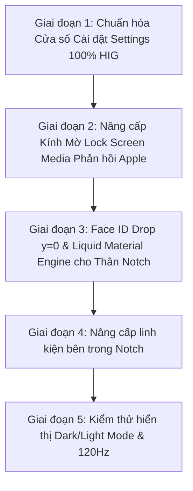

# 💎 NotchPulse Pure Apple Native Transformation Blueprint
> **Tài liệu Kế hoạch Chuyển đổi Toàn diện Kiến trúc & Giao diện NotchPulse đạt chuẩn Apple Native 100% (macOS Sequoia & Sonoma Pure HIG)**

---

## 🧭 1. TÔN CHỈ BẤT KHẢ XÂM PHẠM (CORE MANIFESTO)

> ⭐️ **"Tối đa Native – Không chế cháo – Tự động hòa nhập 100% với macOS"**

1. **Tuyệt đối KHÔNG chế tạo thêm tùy chọn giao diện nhân tạo (Zero Custom Toggles):**
   - Xoá bỏ hoàn toàn các nút chọn "Kính A, Kính B, hay Nền đen lì" trong Settings.
   - Ứng dụng **tự động đồng bộ 100% với hệ thống macOS**:
     - **Dark Mode**: Thân notch/card khi mở tự hoá thành kính mờ hun khói sang trọng (`.regularMaterial` / `.ultraThinMaterial` dark vibrancy), chữ và icon tự chuyển sang màu trắng tương phản chuẩn HIG (`.primary`, `.secondary`).
     - **Light Mode**: Thân notch/card khi mở tự hoá thành kính mờ băng tuyết trắng sữa trong veo, chữ và icon tự chuyển sang màu đen/xám than tương phản cao.
     - Tự động thay đổi màu nhấn theo **Accent Color** mà người dùng cài trong *System Settings > Appearance* của macOS.

2. **Quy tắc "Mỏ Neo Đen Tuyệt Đối" khi Đóng & Inline (The Black Anchor Rule):**
   - **Áp dụng cho cả Màn hình MacBook có Notch lẫn Màn hình Ngoại vi hiển thị dạng Notch**:
     - **Khi ĐÓNG (Closed):** Thân notch luôn là **Đen Tuyền Tuyệt Đối (`#000000`)** đính sát mép trên cùng màn hình (có 2 tai thỏ bo cong mềm mại ra hai bên).
     - **Khi INLINE (Mini HUD thu gọn):** Các trạng thái mini (sóng nhạc, icon pin sạc, âm lượng mini) nằm trọn trên nền đen nguyên bản để không bao giờ lộ camera hoặc viền nhựa bezel.
     - **Với Màn hình chọn kiểu Dynamic Island (Viên thuốc lơ lửng):** Lúc đóng/inline là một viên thuốc đen tuyền nhỏ gọn trôi nổi ở đỉnh.

3. **Quy tắc "Phiến Kính Native Siêu Nét" khi MỞ RỘNG (The Liquid Expanded Drawer):**
   - Khi hover hoặc click để mở bung Notch:
     - **Màn hình hiển thị dạng NOTCH (MacBook hoặc Màn ngoài):** Cục tai thỏ ở đỉnh mép trên **VẪN GIỮ NGUYÊN CỤC ĐEN** làm điểm neo (Camera Anchor) che mắt camera vật lý/mép viền. Chỉ có **toàn bộ phần thân mở rộng trượt xuống bên dưới** mới biến đổi thành **Phiến kính Native (`NSVisualEffectView` / SwiftUI Material)**.
     - **Màn hình hiển thị dạng DYNAMIC ISLAND (Viên thuốc nổi):** Toàn bộ viên thuốc nở to ra thành một tấm thẻ kính mờ trôi nổi đối xứng bốn góc.
   - Bao quanh phiến kính là đường viền tóc chuẩn Apple (`strokeBorder(Color.white.opacity(0.12))` ở Dark Mode và `Color.black.opacity(0.08)` ở Light Mode), tạo chiều sâu lơ lửng đẳng cấp.

4. **Bí thuật Vibrancy & Hiển thị Sắc nét Tuyệt đối (Apple Optical Vibrancy):**
   - Không dùng màu bệt phẳng (`Color.white` hay `Color(white: 0.10)`).
   - Dùng 100% cơ chế **Vibrancy Native của Apple** để trích xuất ánh sáng từ hình nền phía sau, tự động khử răng cưa Sub-pixel cho màn hình Retina, đảm bảo mọi dòng chữ, icon, thanh trượt luôn **sắc sảo, sáng rõ, không bao giờ bị nhoè, đục hay chìm màu**.

5. **Bài học Xương máu từ Thử nghiệm Cũ (Lessons Learned & Anti-Patterns):**
   - ❌ **Không dùng Gradient màu đè lên mép (Cutout Artifact):** Tuyệt đối không dùng `LinearGradient(colors: [Color.black, .clear])` đè lên thanh cuộn ngày Calendar hay danh sách. Trên nền kính xám, việc đè màu đen tạo ra 2 khối chữ nhật đen xì thô kệch. Phải dùng **`.mask(LinearGradient(stops: ...))`** để tác động vào kênh Alpha độ trong suốt của chính nội dung.
   - ❌ **Không nhét hộp lồng trong hộp (Nested Boxy Syndrome):** Tránh đóng khung Music Player thành một hộp xám đục riêng biệt bên trong Notch. Học tập Apple Control Center: tất cả các widget nằm trên **cùng một mặt phẳng kính quang học chung (Unified Surface Material)**, phân tách bằng khoảng thở (spacing) và độ sáng nền nhẹ (`Color.primary.opacity(0.12)`), không tạo khung viền hộp rời rạc.
   - ❌ **Không gán màu cứng (No Hardcoded Hex/RGB):** Không dùng `Color(white: 0.65)` hay các mã màu tĩnh khiến chữ bị "bết" màu. 100% chữ và biểu tượng dùng Semantic Typography (`.primary`, `.secondary`, `.tertiary`).

6. **Quy tắc Thích ứng Đa Thế hệ macOS (Adaptive OS-Native Evolution):**
   - **Không phải lúc nào cũng ép "Full Glass":** Bản chất Apple Native là giao diện **tự động phản hồi theo phong cách của từng đời macOS** mà máy tính đang chạy:
     - **macOS Sequoia (15) / Sonoma (14):** Tận dụng tối đa các vật liệu Liquid Materials, viền phản xạ quang học siêu mỏng, Inset Grouped, và SF Symbols đa sắc (Hierarchical/Multicolor).
     - **macOS Ventura (13) / Monterey (12):** Tự động render theo phong cách của đời đó: bề mặt kính mờ phẳng hơn (`NSVisualEffectView(material: .hudWindow / .menu)`), nền xám chì cổ điển tinh tế của Apple.
   - **Khai báo Ngữ nghĩa (Semantic Declarations):**
     - Không code gán chết "chỗ này phải làm mờ bao nhiêu pixel, màu gì".
     - Chỉ khai báo vai trò ngữ nghĩa của giao diện (`.ultraThinMaterial`, `NSVisualEffectView`, `Color(nsColor: .windowBackgroundColor)`, `.foregroundStyle(.primary)`), để **chính hệ điều hành macOS tự quyết định cách vẽ và mức độ mờ/kính chuẩn xác nhất theo đời hệ thống**.

---

## 🏗️ 2. KIẾN TRÚC THỊ GIÁC: NOTCH vs DYNAMIC ISLAND

### A. MÀN HÌNH HIỂN THỊ DẠNG NOTCH (MacBook & Màn hình ngoài chọn Notch)
```
1. TRẠNG THÁI ĐÓNG (CLOSED):
   ┌────────────────────────────────┐
   │     █ █ █ █ █ █ █ █ █ █ █      │  <- ĐEN TUYỀN 100% (#000000)
   └────────────────────────────────┘     Gắn sát mép trên, hòa vào viền máy.

2. TRẠNG THÁI INLINE MINI (INLINE HUD):
   ┌────────────────────────────────┐
   │ 🔊 50%  █ █ Camera █ █  🔋 98% │  <- VẪN GIỮ NỀN ĐEN 100%
   └────────────────────────────────┘     Chữ và icon trắng nhỏ gọn gắn 2 bên tai.

3. TRẠNG THÁI MỞ RỘNG (EXPANDED):
   ┌────────────────────────────────┐
   │ █ █ █ █ Camera Anchor █ █ █ █  │  <- VẪN GIỮ NGUYÊN CỤC ĐEN Ở ĐỈNH
   │────────────────────────────────│
   │                                │  <- THÂN NỞ RỘNG: KÍNH MỜ NATIVE
   │     TỰ ĐỘNG THEO HỆ THỐNG:     │     - Tự động mờ sương theo Dark/Light
   │   - Khúc xạ hình nền Desktop   │     - Chữ & Icon tự nổi sắc nét (Vibrancy)
   │   - Viền phản xạ ánh sáng mảnh │     - 100% Metal GPU tăng tốc, 120Hz
   │                                │
   └────────────────────────────────┘
```

### B. MÀN HÌNH HIỂN THỊ DẠNG DYNAMIC ISLAND (Viên thuốc nổi)
```
1. TRẠNG THÁI ĐÓNG / INLINE:
   ╭────────────────────────────╮
   │ 🔊 50%  NotchPulse   🔋 98% │  <- VIÊN THUỐC ĐEN NỔI LƠ LỬNG
   ╰────────────────────────────╯     Đổ bóng nhẹ, cách mép trên một khoảng.

2. TRẠNG THÁI MỞ RỘNG (EXPANDED):
   ╭────────────────────────────────╮
   │                                │  <- TOÀN BỘ NỞ THÀNH THẺ KÍNH TRÔI NỔI
   │   PHIẾN KÍNH LIQUID NATIVE     │     - Bo cong 4 góc đối xứng hoàn hảo
   │   - Tự động theo Dark/Light    │     - Không cần cục đen che đỉnh
   │   - Hiển thị siêu sắc nét      │     - Viền bắt sáng siêu mỏng
   │                                │
   ╰────────────────────────────────╯
```

---

## 🔒 3. HOẠT ẢNH THẢ FACE ID TOÀN DIỆN TỪ VIỀN TRÊN (`y = 0`)

> ⭐️ **Quy tắc Bắt buộc:** Khi Face ID quét nhận diện, mở rộng sang 3 bên hoặc thả xuống, hoạt ảnh phải bắt đầu thả **FULL TỪ MÉP VIỀN TRÊN CÙNG CỦA MÀN HÌNH (`y = 0`)**, phủ trùm qua notch vật lý rồi mới tràn xuống/sang hai bên.

1. **Khắc phục lỗi đứt gãy trước đây:**
   - Trước đây hoạt ảnh thả Face ID chỉ bắt đầu từ chân mép dưới của notch vật lý (`y = notchHeight`), tạo cảm giác như một chiếc ngăn kéo rời rạc rơi ra từ đáy notch.
   - **Chuẩn Native Apple:** Toàn bộ khối hình học thả xuống phải bắt đầu từ tọa độ `y = 0` (mép trên cùng tuyệt đối của màn hình). Lớp đen và lớp kính lỏng bao bọc trùm qua cả notch vật lý tạo thành **một khối thống nhất không có đường chia cắt**.
2. **Hình học Thả Sang 3 Bên (Tri-Directional Sweep):**
   - **Mép trên:** Neo chặt tại `y = 0`.
   - **Cánh trái & Cánh phải:** Tràn mượt mà sang 2 bên tai thỏ với đường cong bo tròn liên tục (Continuous Spline Curves).
   - **Đáy dưới:** Hạ xuống bằng lò xo vật lý (`.interpolatingSpring(stiffness: 300, damping: 24)`), tự động co giãn theo trạng thái quét camera hoặc mở khoá thành công.

---

## 🎵 4. CHUẨN HOÁ TRÌNH PHÁT NHẠC LOCK SCREEN (LOCK SCREEN MEDIA - 100% APPLE DECIDED)

> ⭐️ **Tôn chỉ:** Xoá bỏ hoàn toàn hiện tượng thẻ nhạc bị **trắng đục** ở Light Mode hoặc **đen xì tuyệt đối** ở Dark Mode do gán màu chết (`Color.white` / `Color.black`). Mọi độ trong suốt, tán sắc và độ mờ của thẻ Lock Screen Media **100% do engine quang học của Apple quyết định**!

1. **Vật liệu Quang học Tự động theo Hệ điều hành (System Optical Material):**
   - Sử dụng trực tiếp `NSVisualEffectView(material: .fullScreenUI, blendingMode: .behindWindow)` hoặc `.ultraThinMaterial` của SwiftUI.
   - **Tự động phản hồi theo hình nền Lock Screen:** Dù người dùng dùng ảnh tĩnh hay Dynamic Video Wallpaper (macOS Sonoma / Sequoia), phiến kính tự động trích xuất màu sắc và khúc xạ chuyển động phía sau mà không cần code bất kỳ bộ lọc màu giả lập nào.
   - Không chèn thêm bất kỳ background màu đục nào: Không `Color.white.opacity(...)`, không `Color.black.opacity(...)`.
2. **Compact Player Card (Thẻ Mini ở Màn hình Khoá):**
   - Bo góc mềm mại `RoundedRectangle(cornerRadius: 24, style: .continuous)`.
   - Đường viền tóc chuẩn Apple: Viền sáng phản quang siêu mỏng `0.75pt` bắt sáng theo nguồn sáng của hình nền.
   - Typography dùng `.primary` (tự động đảo màu sáng/tối với độ tương phản cao) và `.secondary` cho tên nghệ sĩ.
   - Neo cố định trên màn hình chính, không giật theo chuột khi sử dụng đa màn hình.
3. **Full-Screen Immersive Player (Khi Phóng To Toàn Màn Hình ở Lock Screen):**
   - **Hoạt ảnh Chuyển cảnh (Zoom Transition):** Khi bấm vào thẻ mini hoặc nút phóng to, thẻ bung nở toàn màn hình bằng lò xo mượt mà (`.spring(response: 0.45, dampingFraction: 0.85)`), ảnh bìa album nở to và đẩy trôi dạt sang cột bên trái.
   - **Nền Ambient Gradient Động (Dynamic Fluid Ambient Blur):** 
     - Trích xuất bảng màu chủ đạo (Dominant Palette) từ bìa Album, phóng to làm mờ quang học (`blur(radius: 70)` kết hợp với `Material`) phủ kín màn hình.
     - Nền chuyển động nhẹ nhàng theo nhịp thở của bài hát (Subtle Breathing Motion), tự động thích ứng để dù hình nền sáng hay tối thì chữ và controller vẫn đạt độ tương phản chuẩn Accessibility của Apple.
   - **Bố cục 2 Cột Chuẩn Apple Music Sing:**
     - **Cột Trái (Artwork & Controller):** 
       - Ảnh bìa kích thước lớn (bo góc 24px) có bóng đổ mềm (soft ambient shadow).
       - Tên bài hát, ca sĩ hiển thị lớn, sắc nét với độ phân cấp quang học chuẩn (`.primary` / `.secondary`).
       - Thanh Scrubber thời gian và nút Play/Pause, Next, Volume dạng Capsule kính mờ có phản hồi ánh sáng khi hover/bấm.
       - Bấm vào ảnh bìa để thu nhỏ mượt mà trở lại về thẻ compact mini.
     - **Cột Phải (Live Karaoke Synced Lyrics):**
       - Lời bài hát cuộn thời gian thực đồng bộ theo từng mili-giây.
       - Dòng đang hát: Font SF Pro Rounded cỡ lớn, sáng rực rỡ (100% white glow), tự động cuộn vào trung tâm mắt nhìn.
       - Các dòng trước/sau: Mờ dần (opacity 35%) và áp dụng hiệu ứng làm mờ nhẹ (Gaussian blur) tạo chiều sâu sân khấu chuẩn Apple Music Sing trên Apple TV/iPad.
       - Cho phép click vào bất kỳ câu hát nào để tua nhanh (seek) đến đúng đoạn nhạc đó.

---

## ⚙️ 5. CHUẨN HÓA CỬA SỔ CÀI ĐẶT (SETTINGS - 100% APPLE HIG COMPLIANT)

> ⭐️ **Tôn chỉ:** Cửa sổ Settings phải mang lại cảm giác **như một phân hệ gốc được tích hợp sâu trong System Settings của Apple**, không còn bất kỳ dấu vết nào của giao diện chế cháo (Zero Ad-hoc UI).

```
┌──────────────────────────────────────────────────────────────┐
│ [● ● ●]  Settings                               (Search Bar) │ <- macOS Native Unified Window Toolbar
├───────────────┬──────────────────────────────────────────────┤
│ ⚙️ General     │  ┌────────────────────────────────────────┐  │
│ 🎨 Appearance  │  │ [✨ Tính năng & Giới thiệu]          > │  │ <- macOS Inset Grouped Section Card
│ 🎵 Media       │  └────────────────────────────────────────┘  │    (Bo góc viền kính mờ tự nhiên)
│ 📅 Calendar    │  ┌────────────────────────────────────────┐  │
│ 🔒 Face ID     │  │ Khởi động cùng Mac           [ Bật ]  │  │ <- Native Toggle / Controls
│ 📊 Stats       │  │ Tự động kiểm tra bản mới     [ Bật ]  │  │
│ 💨 Fan & SMC   │  └────────────────────────────────────────┘  │
│ (Sidebar Kính)│  (100% Responsive theo Dark/Light macOS)    │
└───────────────┴──────────────────────────────────────────────┘
```

1. **Thanh Toolbar Hệ thống Thống nhất (Unified Window Toolbar):**
   - Xóa bỏ hoàn toàn thanh `SettingsDetailHeaderBar` tự chế.
   - Sử dụng Window Toolbar chuẩn SwiftUI với Window Titlebar trong suốt (`titlebarAppearsTransparent = true`, `fullSizeContentView`).
   - Tích hợp ô tìm kiếm native `.searchable(...)` để tìm kiếm cài đặt tức thì.
2. **Sidebar Kính Mờ Chuẩn Apple (Native Navigation Sidebar):**
   - Sử dụng `NavigationSplitView` với kiểu `SidebarListStyle()`, nền kính `sidebar` native của AppKit.
   - Các danh mục hiển thị với SF Symbol đặt trong ô vuông bo góc màu tròn trịa (như icon Wi-Fi, Bluetooth, Màn hình trong System Settings của macOS).
3. **Bố cục Thẻ Nhóm Inset Grouped (`.formStyle(.grouped)`):**
   - Các mục cài đặt được gom vào các `Section` bo cong góc chuẩn (`cornerRadius: 10, style: .continuous`), đường kẻ ngăn cách (separator) tự động thụt lề theo chuẩn HIG.
   - Toàn bộ nền form phản hồi 100% theo Dark Mode / Light Mode của macOS mà không cần gán cứng màu sắc.
4. **Kiểm soát Tương tác 100% Native Controls:**
   - Các nút Toggle, Slider, Dropdown Picker, Stepper dùng 100% component gốc của Apple.
   - Màu nhấn (Accent Color) của Toggle và Slider tự động ăn khớp với màu người dùng chọn trong *System Settings > Appearance*.

---

## 🧩 6. NÂNG CẤP CÁC LINH KIỆN NỘI BỘ NOTCH (COMPONENTS)

Loại bỏ toàn bộ các khối màu đen thô cứng bên trong thân notch khi mở rộng, chuyển sang linh kiện native:

| Thành phần | Hiện tại (Custom cũ) | Thiết kế Pure Native Mới |
| :--- | :--- | :--- |
| **Thanh chuyển Tab** | Các viên thuốc `Capsule().fill(.black)` tự vẽ, viền sắc cạnh. | Thanh phân đoạn (Segmented Control) kính mờ, icon tự động bắt sáng khi active. |
| **Thanh trượt (Slider)** | Tự vẽ hình chữ nhật màu xanh/cam cố định bằng DragGesture. | Thanh trượt Capsule kính mờ viền sáng chuẩn Apple, có độ nảy lò xo tự nhiên khi kéo chạm biên. |
| **Trình phát Nhạc (Media)** | Khung nền đen đè lên. | Bề mặt kính mờ khúc xạ nhẹ màu sắc của bìa album (Dynamic Ambient Tinting) mà không dùng hộp đen. |
| **Lịch Âm & Dương** | Bảng vuông nền đen lì. | Lịch kính mờ, ngày hiện tại tự động dùng màu nhấn hệ thống (`Color.accentColor`), mép dùng `.mask` alpha. |
| **Kệ File & Clipboard** | Các ô xám đặc. | Ô kính mờ nhận diện dạng tệp, hover có hiệu ứng sáng viền mềm mại. |
| **Văn bản & Biểu tượng** | Ép chết màu trắng hoặc màu xám hex. | Dùng màu ngữ nghĩa hệ thống: `.primary`, `.secondary`, `.tertiary` để luôn hiển thị sắc sảo ở cả Light Mode lẫn Dark Mode. |

---

## 🛡️ 7. QUY TẮC AN TOÀN BẤT KHẢ XÂM PHẠM (GOLDEN RULES)

Khi thực thi mã nguồn, **bắt buộc tuân thủ 100%** các quy tắc sau:

1. **Bảo toàn Hoạt ảnh Đóng/Mở (Animation Continuity):**
   - **TUYỆT ĐỐI CẤM** dùng cấu trúc `if vm.notchState == .open { ... } else { ... }` ở lớp vỏ ngoài của Notch. Việc tráo đổi danh tính View (View Identity Swap) sẽ gây hiện tượng vỡ khung hình hoặc mở giật bụp.
   - Phải sử dụng phép biến đổi liên tục (Continuous Interpolation) cho lớp nền:
     ```swift
     // Khi đóng: đen 100%. Khi mở: hòa vào vật liệu kính mờ tự nhiên
     .background(
         ZStack {
             if vm.notchState == .closed {
                 Color.black
             } else {
                 Rectangle().fill(.ultraThinMaterial)
             }
         }
     )
     ```
2. **Quy tắc đối xứng hình học 14px:**
   - Luôn duy trì padding ngang đối xứng tuyệt đối giữa trạng thái đóng và mở để khi co giãn notch không bị giật sang hai bên.
3. **Face ID Top-Most Layer & Mép Viền y = 0:**
   - Hệ thống camera Face ID và hoạt ảnh nhận diện luôn nằm ở lớp cao nhất (`.zIndex(999)`), neo thả từ `y = 0` phủ trùm qua notch vật lý để đảm bảo tính liền mạch.
4. **Không làm tăng tải hệ thống (Performance First):**
   - Tận dụng tối đa bộ kết xuất phần cứng Metal của Apple có sẵn trong `NSVisualEffectView` / `Material`.
   - Mức tiêu thụ RAM duy trì ở mức siêu nhẹ (~35–50MB), đảm bảo tần số quét 120Hz mượt mà trên màn hình ProMotion.

---

## 🚀 8. LỘ TRÌNH THỰC THI (IMPLEMENTATION PHASES)



### 📍 Giai đoạn 1: Chuẩn hóa Cửa sổ Settings (Pure HIG)
- [ ] Xóa bỏ `SettingsDetailHeaderBar` tự chế.
- [ ] Chuyển các tab cài đặt sang cấu trúc thẻ Inset Grouped (`.formStyle(.grouped)`).
- [ ] Dùng Sidebar List Style với các icon SF Symbol chuẩn hệ thống.
- [ ] Đồng bộ hóa màu chữ, thanh trượt và toggle theo bảng màu hệ thống macOS.
- [ ] Đảm bảo Settings hiển thị hoàn hảo trên cả Dark Mode và Light Mode.

### 📍 Giai đoạn 2: Nâng cấp Kính Mờ Native cho Lock Screen Media
- [ ] Loại bỏ hoàn toàn màu nền trắng bệt/đen đục gán cứng trong `LockScreenMediaView.swift`.
- [ ] Tích hợp `NSVisualEffectView` / `.ultraThinMaterial` để độ kính mờ 100% do engine quang học Apple quyết định dựa trên hình nền khoá.
- [ ] Bổ sung viền tóc phản quang mỏng bo cong góc 24px.
- [ ] Typography chuẩn `.primary` / `.secondary` tự động phản hồi độ tương phản quang học.

### 📍 Giai đoạn 3: Face ID Drop y = 0 & Liquid Material Engine cho Notch
- [ ] Hoạt ảnh thả Face ID phủ trùm từ đỉnh màn hình `y = 0` xuống và sang 3 bên không đứt gãy.
- [ ] Cập nhật [ContentView.swift](file:///Users/hieukunn/Learning%20ITM/My%20project/NotchPulse/NotchPulse/ContentView.swift): Tích hợp lớp nền chuyển đổi Đóng (Black Anchor) -> Mở (Native Material).
- [ ] Duy trì cụm đen che đỉnh camera vật lý khi ở kiểu Notch (cả màn MacBook và màn ngoài).
- [ ] Thêm đường viền tóc phản quang mảnh chuẩn Apple bao quanh thân mở rộng.

### 📍 Giai đoạn 4: Nâng cấp Linh kiện bên trong Notch
- [ ] Chuyển đổi Card nhạc, Bảng lịch, Ngăn quạt tản nhiệt, Kệ file sang vật liệu kính mờ.
- [ ] Calendar ngày cuộn dùng `.mask(LinearGradient(stops: ...))` thay thế hoàn toàn gradient đen cũ.
- [ ] Thay thế các nút Tab bọc đen lì sang thanh phân đoạn kính mờ tinh tế.
- [ ] Thay thế thanh trượt Volume / Brightness / Fan sang Capsule chuẩn hệ thống.

### 📍 Giai đoạn 5: Kiểm thử và Hoàn thiện
- [ ] Test thực tế khi đổi hình nền Desktop (sáng, tối, rực rỡ, ảnh phong cảnh).
- [ ] Test chuyển đổi qua lại giữa Light Mode và Dark Mode trong System Settings.
- [ ] Kiểm tra độ mượt 120Hz ProMotion và theo dõi RAM/CPU không bị rò rỉ.

---

## 🎛️ 9. BỘ 5 PROMPT THỰC THI CHI TIẾT (EXECUTIVE IMPLEMENTATION PROMPTS)

> 💡 **Hướng dẫn:** Sử dụng tuần tự 5 prompt dưới đây khi bắt đầu từng giai đoạn chuyển đổi mã nguồn để đảm bảo độ chính xác tuyệt đối theo tiêu chuẩn của tài liệu này.

---

### 💎 PROMPT 1: Nâng cấp Kính Mờ Native cho Lock Screen Media
```text
Bạn là chuyên gia SwiftUI và AppKit trên macOS. Hãy thực hiện Giai đoạn 1 trong transformation.md: Nâng cấp Lock Screen Media Player đạt chuẩn 100% Apple Native Liquid Glass.
🎯 CÁC FILE MỤC TIÊU:
- NotchPulse/components/LockScreen/LockScreenMediaView.swift
- NotchPulse/components/LockScreen/LockScreenMediaWindow.swift
🔍 HIỆN TRẠNG CẦN SỬA:
Trong LockScreenMediaView.swift (từ dòng 38 đến 56):
- compactCardBg đang dùng màu bệt phẳng thủ công: isLightMode ? Color.white : Color(white: 0.10).
- compactCardBorder đang dùng màu đục Color.black.opacity(0.12) / Color.white.opacity(0.15) với viền 1.2pt.
- compactPrimaryText và compactSecondaryText đang ép chết màu trắng/đen thủ công.
🛠️ YÊU CẦU THỰC HIỆN:
1. Thay thế nền bệt bằng Apple Native Material:
   - Thay thế toàn bộ compactCardBg trong compactPlayerView bằng vật liệu kính mờ tự nhiên của Apple: .ultraThinMaterial (hoặc NSVisualEffectView làm mờ trực tiếp hình nền Desktop / Lock Screen bên dưới).
2. Tự động thích ứng Dark Mode / Light Mode:
   - Dark Mode: Phiến kính mờ hun khói sang trọng, trích xuất ánh sáng nền.
   - Light Mode: Phiến kính tuyết trắng sữa trong veo.
3. Viền phản quang chuẩn Apple (Specular Highlight Border):
   - Thay thế viền 1.2pt cũ bằng viền bo góc liên tục:
     RoundedRectangle(cornerRadius: 28, style: .continuous).strokeBorder(LinearGradient(colors: [Color.white.opacity(isLightMode ? 0.35 : 0.20), Color.white.opacity(isLightMode ? 0.08 : 0.03)], startPoint: .topLeading, endPoint: .bottomTrailing), lineWidth: 0.8)
4. Chuyển đổi Typography & Icon sang màu Ngữ nghĩa Hệ thống:
   - Dùng .foregroundStyle(.primary) cho tên bài hát và icon chính.
   - Dùng .foregroundStyle(.secondary) cho tên ca sĩ và thời gian.
   - Dùng .foregroundStyle(.tertiary) cho vạch scrubber nền.
   - Tận dụng Apple Optical Vibrancy để chữ và icon luôn sắc nét 100%, không bị bợt hay đục màu trên nền kính mờ.
5. Bảo toàn logic & tính ổn định:
   - GIỮ NGUYÊN cơ chế neo cố định màn hình đã gán (assignedScreenUUID).
   - GIỮ NGUYÊN logic đồng bộ theme AppleInterfaceThemeChangedNotification.
   - GIỮ NGUYÊN chế độ phóng to toàn màn hình Full-Screen Immersive lyrics player và animation mở rộng.
   - Không gây ra bất kỳ lỗi cảnh báo actor isolation nào.
Kiểm tra biên dịch và xác nhận code sạch sau khi hoàn thành.
```

---

### ⚙️ PROMPT 2: Chuẩn hoá Cửa sổ Settings theo macOS Sequoia HIG
```text
Bạn là chuyên gia thiết kế Apple HIG và SwiftUI trên macOS. Hãy thực hiện Giai đoạn 2 trong transformation.md: Chuẩn hoá Cửa sổ Cài đặt Settings đạt chuẩn 100% macOS Sequoia / Sonoma HIG.
🎯 CÁC FILE MỤC TIÊU:
- NotchPulse/components/Settings/SettingsView.swift
- NotchPulse/components/Settings/SettingsWindowController.swift
- Các trang con liên quan trong NotchPulse/components/Settings/
🔍 HIỆN TRẠNG CẦN SỬA:
- Cửa sổ cài đặt đang sử dụng thanh header tự chế SettingsDetailHeaderBar (dòng ~2625 trong SettingsView.swift) với nút "Quit app" tự vẽ.
- Còn tồn tại các tuỳ chọn màu sắc/giao diện thủ công rườm rà.
- Giao diện chưa tận dụng hết cấu trúc thẻ nhóm Inset Grouped bản địa của macOS.
🛠️ YÊU CẦU THỰC HIỆN:
1. Loại bỏ thanh Header tự chế:
   - Xoá bỏ SettingsDetailHeaderBar.
   - Chuyển sang thanh tiêu đề Toolbar nguyên bản của macOS bằng modifier .toolbar { ... } và .navigationTitle(...). Nút đóng/thu nhỏ cửa sổ hòa nhập tự nhiên với thanh tiêu đề.
2. Tự động hoá 100% Giao diện theo macOS:
   - Loại bỏ các toggle chọn giao diện nhân tạo (nếu có). Toàn bộ Settings tự động đồng bộ theo Dark Mode / Light Mode và màu Accent Color của macOS thông qua @Environment(\.colorScheme).
3. Áp dụng cấu trúc Inset Grouped (.formStyle(.grouped)):
   - Chuyển nội dung cài đặt của từng tab (General, Media, Calendar, Face ID, Stats...) vào cấu trúc Form hoặc List với .formStyle(.grouped).
   - Các nhóm cài đặt hiển thị dưới dạng thẻ bo góc mờ tinh tế, có viền mỏng và đổ bóng chuẩn hệ thống.
4. Sidebar Kính Mờ Chuẩn Hệ Thống:
   - Sidebar danh mục sử dụng SidebarListStyle() tận dụng hiệu ứng nền kính mờ NSVisualEffectView(material: .sidebar) tự nhiên của macOS.
5. Bảo toàn chức năng cốt lõi:
   - Tuyệt đối không làm mất bất kỳ key cấu hình @Default(...) hay logic tương tác nào (Face ID enrollment, FaceIDSettingsTab, phím tắt KeyboardShortcuts, cập nhật Sparkle).
   - Đảm bảo biên dịch thành công, không phát sinh lỗi layout hay warning.
```

---

### 🪟 PROMPT 3: Liquid Material Engine cho Thân Notch & Đáy Mở Rộng
```text
Bạn là kỹ sư trưởng hệ thống UI của NotchPulse. Hãy thực hiện Giai đoạn 3 trong transformation.md: Xây dựng Liquid Material Engine cho Thân Notch và Lớp Nền Container Mở Rộng.
🎯 CÁC FILE MỤC TIÊU:
- NotchPulse/ContentView.swift
- NotchPulse/components/Notch/NotchShape.swift
🔍 HIỆN TRẠNG CẦN SỬA:
Trong ContentView.swift (từ dòng 352 đến 411):
- mainNotchContainer đang dùng .background(.black) cố định và dòng 587 bị ép .preferredColorScheme(.dark).
- Mở rộng Notch hiện tại đang là một khối đen tuyền đặc, che mất hình nền Desktop thay vì hiệu ứng kính khúc xạ chuẩn Apple.
⚠️ QUY TẮC BẤT KHẢ XÂM PHẠM (CRITICAL RULES):
1. TUYỆT ĐỐI CẤM dùng if/else hoán đổi View Identity (_ConditionalContent) ở lớp vỏ container ngoài cùng của Notch. Việc này sẽ phá hủy hoạt ảnh lò xo (Spring Physics) và gây giật khung hình.
2. Luôn duy trì padding ngang đối xứng 14px ở cả trạng thái đóng và mở.
3. Face ID phải luôn nằm ở tầng cao nhất: .zIndex(999).
🛠️ YÊU CẦU THỰC HIỆN:
1. Quy tắc Mỏ Neo Đen (The Black Anchor Rule):
   - Khi ĐÓNG hoặc INLINE (Mini HUD): Nền Notch bắt buộc phải là ĐEN TUYỀN TUYỆT ĐỐI #000000 (áp dụng cho cả màn hình MacBook lẫn màn hình ngoài hiển thị dạng Notch) để hòa vào viền bezel và camera máy.
   - Nếu màn hình chọn dạng DYNAMIC ISLAND (viên thuốc nổi): Khi đóng là một viên thuốc đen nổi lơ lửng.
2. Quy tắc Phiến Kính Liquid khi MỞ RỘNG (The Liquid Expanded Drawer):
   - Khi hover/click mở bung Notch:
     - Với kiểu NOTCH: Giữ nguyên dải mỏ neo đen ở mép trên cùng (Camera Anchor che cụm camera vật lý). Toàn bộ phần thân nở rộng trượt xuống dưới được lót bằng phiến kính Native (.ultraThinMaterial / NSVisualEffectView) tự động khúc xạ hình nền Desktop theo Dark/Light Mode.
     - Với kiểu DYNAMIC ISLAND: Nở to thành phiến thẻ kính mờ trôi nổi đối xứng 4 góc bo tròn.
3. Viền Phản Quang Tinh Tế (Specular Edge):
   - Bao quanh phiến kính mở rộng bằng đường viền tóc mảnh 0.8pt có gradient phản xạ ánh sáng nhẹ (Color.white.opacity(0.12) ở Dark Mode, Color.black.opacity(0.08) ở Light Mode).
4. Thích ứng Hệ thống:
   - Điều chỉnh .preferredColorScheme(.dark) để khi mở rộng, Notch tự động nhận diện Light/Dark Mode theo hệ thống, hiển thị đúng độ tương phản Vibrancy.
5. Đảm bảo 120Hz ProMotion:
   - Hoạt ảnh co giãn của lớp nền kính phải đồng bộ tuyệt đối với animationSpring của kích thước Notch, không rớt khung hình.
```

---

### 🧩 PROMPT 4: Nâng cấp Linh kiện Nội bộ Notch (Components & Navigation)
```text
Bạn là chuyên gia SwiftUI trên macOS. Hãy thực hiện Giai đoạn 4 trong transformation.md: Nâng cấp toàn diện các linh kiện nội bộ bên trong thân Notch khi mở rộng theo chuẩn Apple Native.
🎯 CÁC FILE MỤC TIÊU:
- NotchPulse/components/Notch/NotchPulseHeader.swift
- NotchPulse/components/Tabs/TabSelectionView.swift
- NotchPulse/components/Notch/NotchHomeView.swift
- Các thanh trượt/nút bấm trong NotchPulse/components/
🔍 HIỆN TRẠNG CẦN SỬA:
- Các nút chuyển Tab (TabSelectionView.swift) và nút action ở Header (NotchPulseHeader.swift) đang dùng các viên thuốc đen Capsule().fill(.black) tự vẽ, viền sắc cạnh và cục mịch.
- Thanh trượt âm lượng/độ sáng (VolumeControlView, CustomSlider) vẽ thủ công bằng DragGesture màu bệt.
- Văn bản và biểu tượng đang ép cứng màu trắng (Color.white) hoặc xám tĩnh.
🛠️ YÊU CẦU THỰC HIỆN:
1. Nâng cấp Thanh Chuyển Tab (Tab Selection):
   - Trong TabSelectionView.swift: Thay thế Capsule().fill(.black) bằng thanh phân đoạn kính mờ (Segmented Glass Bar).
   - Tab đang chọn (Active) lướt chuyển mượt mà bằng .matchedGeometryEffect với nền kính sáng mờ nhẹ và viền bắt sáng tinh xảo.
   - Icon và nhãn tab tự đổi màu tương phản chuẩn HIG (.primary khi chọn, .secondary khi không chọn).
2. Nâng cấp Các Nút Action trên Header:
   - Trong NotchPulseHeader.swift: Thay thế các nút bọc Capsule().fill(.black) (nút Audio Hub, Camera Preview, Settings) bằng nút tròn kính mờ native, hiệu ứng hover làm sáng viền mượt mà.
3. Nâng cấp Thanh Trượt (Sliders):
   - Chuyển đổi thanh trượt âm lượng và độ sáng sang dạng Capsule kính mờ viền sáng chuẩn Apple (tương tự Control Center macOS).
   - Thêm phản hồi độ nảy lò xo tự nhiên khi kéo chạm mốc 0% hoặc 100%.
4. Tích hợp Dynamic Ambient Tinting cho Card Nhạc:
   - Trong NotchHomeView.swift: Card nhạc không dùng hộp đen đè lên. Bề mặt kính mờ khúc xạ nhẹ ánh sáng màu của bìa album (avgColor) một cách tinh tế.
5. Chuẩn hoá Typography & Vibrancy:
   - Thay thế toàn bộ mã màu cứng (Color.white, Color.gray, hex) bằng màu ngữ nghĩa hệ thống: .foregroundStyle(.primary), .foregroundStyle(.secondary), .foregroundStyle(.tertiary).
   - Chữ và icon tự động sắc nét trên màn hình Retina ở cả chế độ ban ngày và ban đêm.
```

---

### 🧪 PROMPT 5: Kiểm thử Hiển thị Dark/Light, 120Hz & Build Sanity Check
```text
Bạn là kỹ sư QA và CI/CD của NotchPulse. Hãy thực hiện Giai đoạn 5 trong transformation.md: Kiểm thử toàn diện, tối ưu hiệu năng và xác thực tính toàn vẹn bản dựng sau khi nâng cấp Apple Native.
⚠️ QUY TẮC RÀNG BUỘC CỦA DỰ ÁN:
- TUYỆT ĐỐI KHÔNG bump version, không đổi build number, không tạo tag git và không trigger release workflow (theo AGENTS.md).
- Chỉ kiểm tra tính đúng đắn của code, độ mượt mà và biên dịch sạch.
🛠️ YÊU CẦU THỰC HIỆN:
1. Biên dịch Dự án (Build Sanity Check):
   - Chạy lệnh build Xcode để kiểm tra mã nguồn:
     xcodebuild -workspace NotchPulse.xcworkspace -scheme NotchPulse -destination 'platform=macOS' clean build (hoặc xcodebuild tương ứng với project).
   - Đảm bảo 0 lỗi biên dịch, 0 cảnh báo về Sendable/Actor Isolation, và không thiếu import.
2. Kiểm tra Hiển thị Đa Chế độ (Visual Verification):
   - Kiểm tra giao diện khi chuyển đổi Dark Mode <-> Light Mode trong macOS System Settings:
     + Thân Notch khi đóng: Vẫn đen tuyền 100% che camera.
     + Thân Notch khi mở: Kính mờ hun khói ở Dark Mode, kính sữa tuyết ở Light Mode, chữ và icon tương phản sắc sảo.
     + Lock Screen Media: Kính mờ nổi bật trên hình nền khoá, chữ không bị chìm.
     + Settings: Thẻ Inset Grouped hiển thị chuẩn mực HIG.
3. Kiểm tra Độ Mượt 120Hz ProMotion:
   - Xác nhận animation lò xo khi mở/đóng Notch không có hiện tượng giật, nhảy kích thước (glitch), hay đứt đoạn chuyển động.
   - Đảm bảo không xảy ra hiện tượng memory leak (mức tiêu thụ RAM duy trì siêu nhẹ quanh ~35-50MB).
4. Báo cáo Tóm tắt Kết quả:
   - Tổng kết các cải tiến đã đạt được so với tiêu chuẩn trong transformation.md.
```

---

*Bản kế hoạch này là kim chỉ nam tối thượng cho quá trình đưa NotchPulse trở thành ứng dụng Native đỉnh cao nhất trên macOS.*
