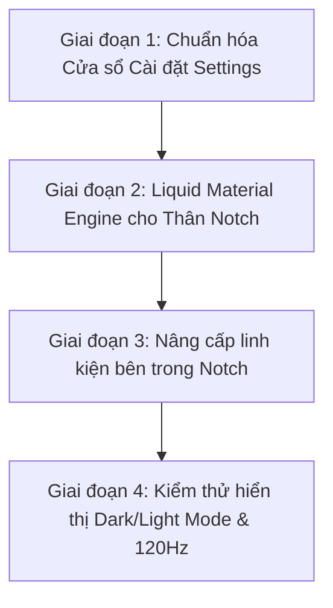

# 💎 NotchPulse Pure Native Transformation Blueprint
> **Tài liệu Kế hoạch Chuyển đổi Toàn diện Kiến trúc & Giao diện NotchPulse đạt chuẩn Apple Native 100% (macOS Sequoia & Sonoma Pure HIG)**

---

## 🧭 1. TÔN CHỈ BẤT KHẢ XÂM PHẠM (CORE MANIFESTO)

> ⭐️ **"Tối đa Native – Không chế cháo – Tự động hòa nhập 100% với macOS"**

1. **Tuyệt đối KHÔNG chế tạo thêm tùy chọn giao diện (Zero Custom Appearance Toggles):**
   - Không bắt người dùng phải chọn "kính mờ kiểu A, kính mờ kiểu B hay nền đen lì" trong Settings.
   - Ứng dụng phải **tự động đồng bộ 100% với hệ thống macOS**:
     - Khi máy ở **Dark Mode**: Notch mở ra tự động hóa thành phiến kính hun khói tối (`.regularMaterial` / `.ultraThinMaterial` dark vibrancy), chữ và biểu tượng màu trắng tương phản chuẩn HIG.
     - Khi máy ở **Light Mode**: Notch mở ra tự động hóa thành phiến kính băng tuyết trong trẻo, chữ và biểu tượng màu đen/xám than (`.primary`, `.secondary`), khúc xạ trực tiếp màu sắc của hình nền desktop.
     - Tự động thay đổi màu nhấn theo **Accent Color** mà người dùng cài trong *System Settings > Appearance* của Mac.

2. **Quy tắc "Đen Tuyệt Đối" khi Đóng & Inline (The Black Anchor Rule):**
   - **Khi ĐÓNG (Closed):** Thân notch ngoài PHẢI là **Đen Tuyền Tuyệt Đối (`#000000`)** để hòa làm một với viền bezel màn hình và che giấu hoàn toàn cụm camera vật lý của MacBook.
   - **Khi INLINE (Mini HUD thu gọn):** Các trạng thái hiển thị mini gắn trên notch (như icon sạc pin, âm lượng mini, sóng âm mini cạnh tai thỏ) PHẢI nằm trọn trên nền đen nguyên bản để không làm lộ camera.

3. **Quy tắc "Kính Mờ Native" khi MỞ RỘNG (The Liquid Expanded Drawer):**
   - Khi hover hoặc click để mở bung Notch: Thân notch mở rộng mượt mà biến đổi thành **Phiến kính Native (`NSVisualEffectView` / SwiftUI Material)**.
   - Vẫn duy trì một **Camera Anchor Mask (Mặt nạ Đen)** nhỏ ở đỉnh mép trên đúng vị trí camera vật lý để mắt thần camera không bị lộ khi thân kính mờ trượt xuống.
   - Bao quanh phiến kính là đường viền tóc chuẩn Apple (`strokeBorder(Color.white.opacity(0.12))` ở Dark Mode và `Color.black.opacity(0.08)` ở Light Mode), tạo chiều sâu lơ lửng đẳng cấp.

4. **Cửa sổ Cài đặt Chuẩn mực HIG (Pure Settings Window):**
   - Xóa bỏ toàn bộ các thanh header tự chế, xóa bỏ nút Quit tự vẽ.
   - Sử dụng 100% **macOS Unified Toolbar** và phong cách **Grouped Card (`.formStyle(.grouped)`)** giống hệt ứng dụng System Settings của macOS Sequoia.

---

## 🏗️ 2. KIẾN TRÚC THỊ GIÁC: ĐÓNG vs INLINE vs MỞ

```
1. TRẠNG THÁI ĐÓNG (CLOSED):
   ┌────────────────────────────────┐
   │     █ █ █ █ █ █ █ █ █ █ █      │  <- ĐEN TUYỀN 100% (#000000)
   └────────────────────────────────┘     Hòa hoàn toàn vào viền Bezel MacBook.

2. TRẠNG THÁI INLINE MINI (INLINE HUD):
   ┌────────────────────────────────┐
   │ 🔊 50%  █ █ Camera █ █  🔋 98% │  <- VẪN GIỮ NỀN ĐEN 100%
   └────────────────────────────────┘     Chữ và icon trắng nhỏ gọn gắn 2 bên tai.

3. TRẠNG THÁI MỞ RỘNG (EXPANDED):
   ┌────────────────────────────────┐
   │ █ █ █ █ Camera Anchor █ █ █ █  │  <- Vẫn giữ dải đen nhỏ che camera vật lý
   │────────────────────────────────│
   │                                │  <- LIQUID NATIVE MATERIAL (NSVisualEffectView)
   │     TỰ ĐỘNG THEO HỆ THỐNG:     │     - Light Mode: Kính băng tuyết xuyên thấu
   │   - Khúc xạ hình nền Desktop   │     - Dark Mode: Kính hun khói chiều sâu
   │   - Viền phản xạ ánh sáng mảnh │     - Chữ/Icon tự đảo màu tương phản
   │                                │
   └────────────────────────────────┘
```

---

## ⚙️ 3. CHUẨN HÓA CỬA SỔ CÀI ĐẶT (SETTINGS - 100% APPLE HIG)

Hiện tại, `SettingsView.swift` sử dụng thanh header tự chế (`SettingsDetailHeaderBar`), làm mất đi vẻ sang trọng của macOS. Chúng ta sẽ chuẩn hóa toàn diện:

```
┌──────────────────────────────────────────────────────────────┐
│ [● ● ●]  General Settings                       (Search Bar) │ <- macOS Native Unified Window Toolbar
├───────────────┬──────────────────────────────────────────────┤
│ ⚙️ General     │  ┌────────────────────────────────────────┐  │
│ 🎨 Appearance  │  │ [✨ Tính năng & Giới thiệu]          > │  │ <- macOS Sequoia Grouped Inset Card
│ 🎵 Media       │  └────────────────────────────────────────┘  │    (Bo góc viền kính mờ tự nhiên)
│ 📅 Calendar    │  ┌────────────────────────────────────────┐  │
│ 🔒 Face ID     │  │ Khởi động cùng Mac           [ Bật ]  │  │
│ 📊 Stats       │  │ Tự động kiểm tra bản mới     [ Bật ]  │  │
│ 💨 Fan & SMC   │  └────────────────────────────────────────┘  │
│ (Sidebar Kính)│  (Nền toàn bộ tự động theo Dark/Light macOS) │
└───────────────┴──────────────────────────────────────────────┘
```

### Các việc cụ thể trong Settings:
1. **Loại bỏ hoàn toàn code tùy chọn "giao diện kính A, B, C":** App tự động nhận diện chế độ hiển thị của hệ thống qua `@Environment(\.colorScheme)`.
2. **Áp dụng `.formStyle(.grouped)`:**
   - Toàn bộ các trang cài đặt (General, Media, Calendar, Face ID, Stats...) chuyển sang dạng các thẻ bo góc (Inset Grouped Cards) với đường viền mờ tinh tế và đổ bóng chuẩn hệ thống.
3. **Thanh Toolbar Hệ thống:**
   - Sử dụng `.toolbar` chuẩn của macOS SwiftUI, tự động tích hợp nút đóng/mở/thu nhỏ góc trái và tiêu đề căn giữa đồng bộ.
4. **Sidebar chuẩn mực:**
   - Sử dụng `SidebarListStyle()` với hiệu ứng nền kính mờ `sidebar` của AppKit/SwiftUI.

---

## 🧩 4. NÂNG CẤP CÁC LINH KIỆN NỘI BỘ NOTCH (COMPONENTS)

Loại bỏ toàn bộ các khối màu đen thô cứng bên trong thân notch khi mở rộng, chuyển sang linh kiện native:

| Thành phần | Hiện tại (Custom cũ) | Thiết kế Pure Native Mới |
| :--- | :--- | :--- |
| **Thanh chuyển Tab** | Các viên thuốc `Capsule().fill(.black)` tự vẽ, viền sắc cạnh. | Thanh phân đoạn (Segmented Control) kính mờ, icon tự động bắt sáng khi active. |
| **Thanh trượt (Slider)** | Tự vẽ hình chữ nhật màu xanh/cam cố định bằng DragGesture. | Thanh trượt Capsule kính mờ viền sáng chuẩn Apple, có độ nảy lò xo tự nhiên khi kéo chạm biên. |
| **Trình phát Nhạc (Media)** | Khung nền đen đè lên. | Bề mặt kính mờ khúc xạ nhẹ màu sắc của bìa album (Dynamic Ambient Tinting) mà không dùng hộp đen. |
| **Lịch Âm & Dương** | Bảng vuông nền đen lì. | Lịch kính mờ, ngày hiện tại tự động dùng màu nhấn hệ thống (`Color.accentColor`). |
| **Kệ File & Clipboard** | Các ô xám đặc. | Ô kính mờ nhận diện dạng tệp, hover có hiệu ứng sáng viền mềm mại. |
| **Văn bản & Biểu tượng** | Ép chết màu trắng hoặc màu xám hex. | Dùng màu ngữ nghĩa hệ thống: `.primary`, `.secondary`, `.tertiary` để luôn hiển thị hoàn hảo ở cả Light Mode lẫn Dark Mode. |

---

## 🛡️ 5. QUY TẮC AN TOÀN BẤT KHẢ XÂM PHẠM (GOLDEN RULES)

Khi thực thi mã nguồn, **bắt buộc tuân thủ 100%** các quy tắc sau:

1. **Bảo toàn Hoạt ảnh Đóng/Mở (Animation Continuity):**
   - **TUYỆT ĐỐI CẤM** dùng cấu trúc `if vm.notchState == .open { ... } else { ... }` ở lớp vỏ ngoài của Notch. Việc tráo đổi danh tính View (View Identity Swap) sẽ gây hiện tượng vỡ khung hình hoặc mở giật bụp.
   - Phải sử dụng phép biến đổi liên tục (Continuous Interpolation) cho lớp nền:
     ```swift
     // Khi đóng: đen 100%. Khi mở: hòa vào vật liệu kính mờ tự nhiên
     .background(
         ZStack {
             if vm.notchState == .closed {
                 Color.black
             } else {
                 Rectangle().fill(.ultraThinMaterial)
             }
         }
     )
     ```
2. **Quy tắc đối xứng hình học 14px:**
   - Luôn duy trì padding ngang đối xứng tuyệt đối giữa trạng thái đóng và mở để khi co giãn notch không bị giật sang hai bên.
3. **Face ID Top-Most Layer (`.zIndex(999)`):**
   - Hệ thống camera Face ID và hoạt ảnh nhận diện luôn nằm ở lớp cao nhất, không bị bất kỳ lớp kính hay hiệu ứng nào che khuất.
4. **Không làm tăng tải hệ thống (Performance First):**
   - Tận dụng tối đa bộ kết xuất phần cứng Metal của Apple có sẵn trong `NSVisualEffectView` / `Material`.
   - Mức tiêu thụ RAM duy trì ở mức siêu nhẹ (~35–50MB), đảm bảo tần số quét 120Hz mượt mà trên màn hình ProMotion.

---

## 🚀 6. LỘ TRÌNH THỰC THI (IMPLEMENTATION PHASES)



### 📍 Giai đoạn 1: Chuẩn hóa Cửa sổ Settings (Pure HIG)
- [ ] Xóa bỏ `SettingsDetailHeaderBar` tự chế.
- [ ] Chuyển các tab cài đặt sang cấu trúc thẻ Inset Grouped (`.formStyle(.grouped)`).
- [ ] Đồng bộ hóa màu chữ, thanh trượt và toggle theo bảng màu hệ thống macOS.
- [ ] Đảm bảo Settings hiển thị hoàn hảo trên cả Dark Mode và Light Mode.

### 📍 Giai đoạn 2: Xây dựng Liquid Material Engine cho Notch
- [ ] Cập nhật [ContentView.swift](file:///Users/hieukunn/Learning%20ITM/My%20project/NotchPulse/NotchPulse/ContentView.swift): Tích hợp lớp nền chuyển đổi Đóng (Black) -> Mở (Native Material).
- [ ] Bố trí dải mặt nạ đen che cụm camera vật lý ở mép trên cùng khi mở.
- [ ] Thêm đường viền tóc phản quang mảnh chuẩn Apple bao quanh thân mở rộng.

### 📍 Giai đoạn 3: Nâng cấp Linh kiện bên trong Notch
- [ ] Chuyển đổi Card nhạc, Bảng lịch, Ngăn quạt tản nhiệt, Kệ file sang vật liệu kính mờ.
- [ ] Thay thế các nút Tab bọc đen lì sang thanh phân đoạn kính mờ tinh tế.
- [ ] Thay thế thanh trượt Volume / Brightness / Fan sang Capsule chuẩn hệ thống.

### 📍 Giai đoạn 4: Kiểm thử và Hoàn thiện
- [ ] Test thực tế khi đổi hình nền Desktop (sáng, tối, rực rỡ, ảnh phong cảnh).
- [ ] Test chuyển đổi qua lại giữa Light Mode và Dark Mode trong System Settings.
- [ ] Kiểm tra độ mượt 120Hz ProMotion và theo dõi RAM/CPU không bị rò rỉ.

---

*Bản kế hoạch này là kim chỉ nam tối thượng cho quá trình đưa NotchPulse trở thành ứng dụng Native đỉnh cao nhất trên macOS.*
